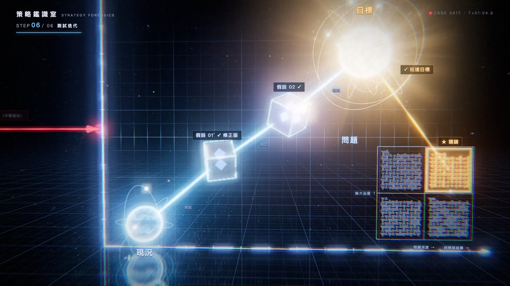

# 策略鑑識室 · Strategy Forensics 3D

把一支〈策略思考〉教學圖解影片，改編成可以走進去的 3D 推理現場。

**▶ 線上體驗：https://pokemonida99.github.io/strategy-forensics-3d/**



## 內容

原圖的座標（X＝時間與組織、Y＝解決方式的品質）變成一座立體圖表，6 個步驟依序展開：

1. **全圖導覽**：座標軸從地面亮起，看清整張圖
2. **現況**：冷光能量球，市場・顧客・企業三道軌道；左側「上層理想」是一道到不了的紅色雷射
3. **問題**：420 片證據碎片 → 親和分群 → MECE 2×2 矩陣 → 「關鍵」格亮起
4. **目標**：配樂爆發的瞬間點燃恆星，七道檢驗環依序扣上（明確、可衡量、可達成、相關、有時限、具挑戰、道德）
5. **假設**：玻璃晶體成形，資源粒子注入，雷射掃描「具體・可驗證」
6. **測試迭代**：測試脈衝讓假設裂開、碎裂、定格，再重組成修正版，一路驗證到目標

## 操作

- 拖曳旋轉、滾輪縮放、右鍵平移（手機：單指旋轉、雙指縮放）
- 滑鼠移到節點：顯示「重點操作」卡片；點節點：跳到該步驟
- 點地面：漣漪；雙擊：發射貫穿全程的推理脈衝
- 下方控制列：步驟 1～6、播放／暫停、時間軸、音量；空白鍵播放，←／→ 切換步驟

## 技術

- Three.js r160：反射地板（Reflector）、玻璃材質（transmission + iridescence）、InstancedMesh 碎片、GPU 粒子、自製 shader（恆星、日冕、光束、衝擊波）
- 後製：UnrealBloom 泛光、色差、底片顆粒、暗角
- 所有畫面只由「故事時間」決定，同一條時間軸可以即時互動，也可以逐格錄成影片（`tools/record.mjs`）
- 配樂的音量與節拍事先算好（`tools/audio_env.mjs`），畫面跟著節拍脈動
- 依幀率自動調整渲染解析度

```bash
npm install
npm run build   # src/main.js → app.js
```

## 授權與來源

- 配樂：“Volatile Reaction” Kevin MacLeod (incompetech.com)，Licensed under Creative Commons: By Attribution 4.0
- 內容改編自〈策略思考〉教學圖解影片，練習作品
